```{=html}
<style>
/* Figures are sized as a share of the text column; on phones use the full width. */
@media (max-width: 600px) { .quarto-figure img.figure-img { width: 100% !important; } }
</style>
```

[Paper](https://arxiv.org/abs/2604.11581){.btn-paper} [SI Appendix](/pdf/totalevalerror_si.pdf){.btn-paper} [R package](https://github.com/SolomonMg/totalevalerror){.btn-paper} [Replication](https://github.com/SolomonMg/totalevalerror-replication){.btn-paper} [Follow](https://twitter.com/SolomonMg){.btn-paper}

LLM evaluations drive model deployment, safety standards, and research. Yet we ignore noise from the prompt, the judge, the agent harness, and so on. So we underestimate error in benchmarking and in annotation, and the problem gets worse with more data.

So I argue in [Hidden Measurement Error in LLM Pipelines Distorts Annotation, Evaluation, and Benchmarking](https://arxiv.org/abs/2604.11581). I'll get to what this means for confidence intervals and how to fix it. But first, let's talk about how this makes benchmark hacking easier.

**Benchmark hacking**

Benchmark hacking (like p-hacking) is where you test many versions of a model with slightly different setups and only publish the best score. It depicts noise as signal.

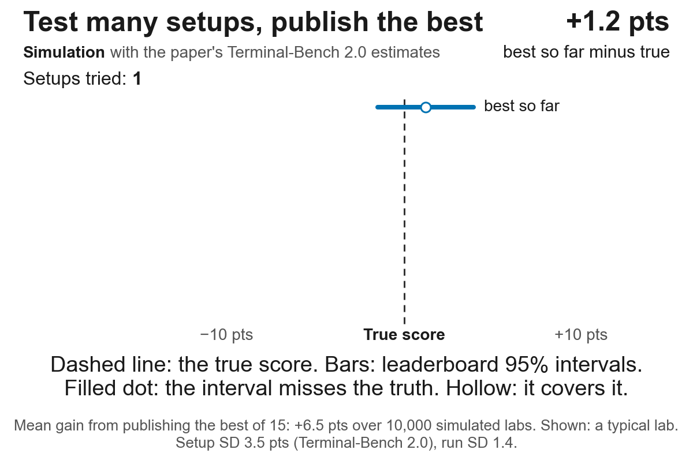{width="85%" fig-alt="Animation of a simulated lab trying one model under 15 setups. The published best lands 6.5 points above the true score and its interval misses it, while the interval from averaging all 15 setups covers it."}

Are labs doing this? If so, on the most prized benchmarks we should see higher scores on their own runs than from independent evaluators. Indeed, on SWE-bench Verified, labs' launch scores beat independent runs by 4 to 5 points on average. Unique harness and other settings likely drive much of the difference. One lab's launch scores for two models, for example, used a "minor prompt addition" telling the model to "use tools as much as possible, ideally more than 100 times" and to write its own tests first. One of those runs scored 6 points above Epoch's run of the same model. To be clear the lab disclosed this, and later launches report prompt-modified scores separately. (This analysis and the next are meant to tie this to the real world and are not in the paper.)

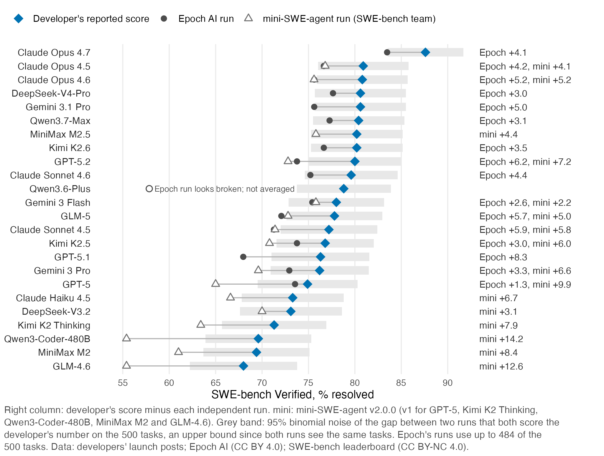{width="75%" fig-alt="Dot plot: for every model, the developer's reported SWE-bench Verified score sits to the right of the independent runs by Epoch AI and the SWE-bench team."}

More evidence comes from Terminal-Bench 2.0 data, another high-value benchmark. When labs used a different agent harness and settings, like Codex or Claude Code, they reported scores 7 to 19 points above the same model on the benchmark's default harness, Terminus 2. That's for the six models with a Terminus 2 run on the leaderboard. Note also that in [runs that Alibaba's Qwen team published](https://arxiv.org/abs/2603.00729) of other labs' models, tool-call format moved scores by up to 11 points, and which format did better depended on the model.

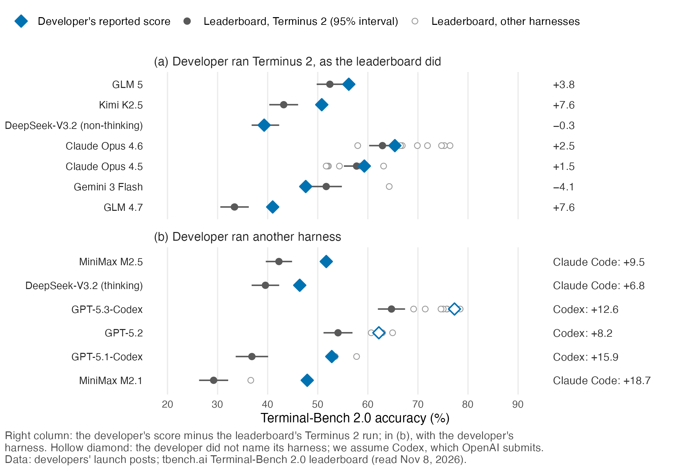{width="75%" fig-alt="Developers who used a different harness reported Terminal-Bench 2.0 scores 7 to 19 points above the leaderboard's run of the same model."}

Is it the harness, or are labs just picking their best runs? Wiz's Cyber Model Arena, a security benchmark, helps tell these apart, because Wiz ran every model itself. It ran 22 models in two harnesses: Claude Code (Anthropic's coding agent) and a simple baseline with one bash tool (ADK React). On average, Claude models scored 7.5 points higher in Claude Code than in the baseline, whereas other developers' models scored only 0.8 points higher. So a developer's harness can work better for its own models. That said, it doesn't always: on average, Gemini models scored 2.4 points lower in Google's own harness (Antigravity) than in the baseline. This analysis is also not in the paper.

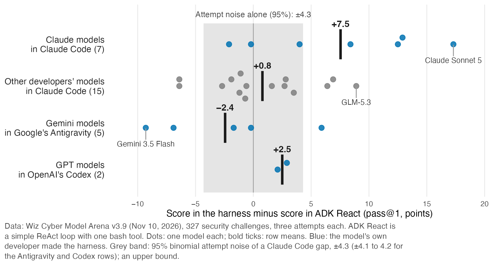{width="80%" fig-alt="Strip plot of score differences against a simple baseline harness on Wiz's Cyber Model Arena. Claude models average +7.5 points in Claude Code, other developers' models +0.8, Gemini models -2.4 in Google's Antigravity, and GPT models +2.5 in OpenAI's Codex."}

Is using a better harness really "noise?" Well, scores depend on the harness, and different harnesses help different models. So if we're trying to measure capability and we ignore the harness there's hidden variability.

Benchmark hacking is a different problem from "benchmaxxing," which mostly means post-training on tasks that mimic a benchmark.

<details>
  <summary>More about benchmarks and benchmaxxing</summary>

Evaluators do try to combat other problems, such as test items leaking into training data or agents gaming the grader. To deal with test items in the training data, [SWE-Bench Pro](https://scale.com/blog/swe-bench-pro) holds back 858 of its tasks and takes 276 more from private company codebases, and [SWE-rebench](https://swe-rebench.com) keeps scoring models on recent GitHub tasks and labels results that may be contaminated. 

Other countermeasures focus on actions agents take during an eval run. For example, on SWE-bench, agents fix real GitHub issues. In the past, sometimes the very GitHub repo contained the bug fix, which agents promptly copied ([SWE-bench issue #465](https://github.com/SWE-bench/SWE-bench/issues/465)). [SWE-bench Pro V2](https://labs.scale.com/blog/swe-bench-pro-v2) builds its evals without these answers. The benchmark sandbox also generally blocks internet access so the agent can't look it up online either. In [Terminal-Bench 4.1](https://www.tbench.ai/news/terminal-bench-4-1), they took measures to prevent reward hacking, and the leaderboard's [integrity rules](https://www.tbench.ai/news/leaderboard-integrity-update) call for an agent judge to review every trial an agent passes.

To help prevent benchmark contamination, [ARC Prize](https://arcprize.org/policy) tests models on its own semi-private eval set and reports every run so the lab can't simply pick the best. ARC calls the set semi-private because its tasks pass through APIs, which our [double-blind evaluation system](https://deepmind.google/blog/piloting-the-worlds-first-double-blind-ai-evaluations/) will go a long way toward solving. Epoch AI, Vals.ai, and the SWE-bench and Terminal-Bench teams also rerun models under their own setups, but that usually comes after the lab has published its benchmark number. Before launch, there's little to stop a lab from trying many harnesses, prompts, or compute settings and reporting the best.

</details>

Research using LLM judges for annotation (autoraters) has the same problem. [Baumann, Röttger, and colleagues (2025)](https://arxiv.org/abs/2509.08825) re-evaluated 37 LLM annotation tasks from 21 studies. They found that 31% of hypothesis tests on LLM-labeled data reached wrong conclusions under other models and prompts, and that adversarial choices could flip the sign of 68% of significant effects.

**Why naive error bars get worse with more data**

Current practice is to report confidence intervals (CIs) that treat items as a sample but fix the prompt, judge, and harness. We should expect under-coverage to worsen with more items, because omitted variance from prompt and judge choices does not shrink with N.

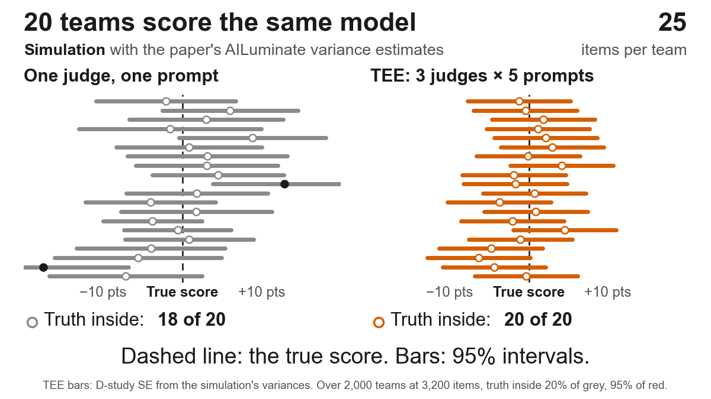{width="85%" fig-alt="As items grow, 20 simulated teams' one-judge intervals (grey) narrow and most miss the true score, while 19 of 20 TEE intervals (orange) still cover it."}

In the paper's simulation, as we add items, the usual interval (A) contains the truth less often: 42% of the time at 25 items and 11% at 400. Once we add the omitted prompt, judge, and temperature variance, coverage is back above 95%.

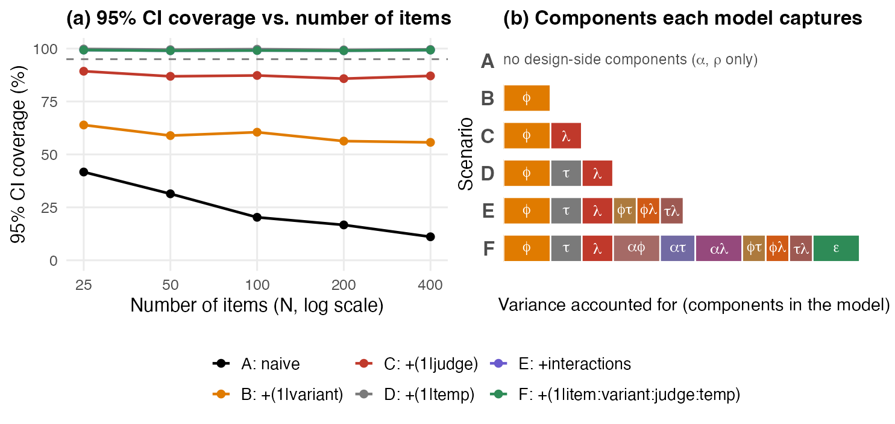{width="85%" fig-alt="The naive 95% interval covers the truth less often as items increase, and adding prompt, judge, and temperature variance brings coverage back above 95%."}

By the way, sometimes you hear "Just set the temperature to zero," which does NOT fix this. Doing so picks the single most likely token at each step (greedy decoding), which simply further *hides* the variation that sampling would have shown. Note that infrastructure nondeterminism alone has produced standard deviations of up to nine percentage points in task accuracy at temperature zero (Yuan et al. 2025).

**What undercoverage looks like on a leaderboard**

We see this play out on Terminal-Bench 4.0, where I found data for Vals.ai and the official board runs on the same 66 tasks on the same 39 models. The tasks are the same so the difference between a model's scores on the two runs comes from rerun noise plus differences in how each evaluator ran the model. Both boards' error bars count only reruns. If they captured all the noise, about 5% of pairs would differ by more than their 95% intervals allow. 21% do (8 of 39). This analysis is also not in the paper.

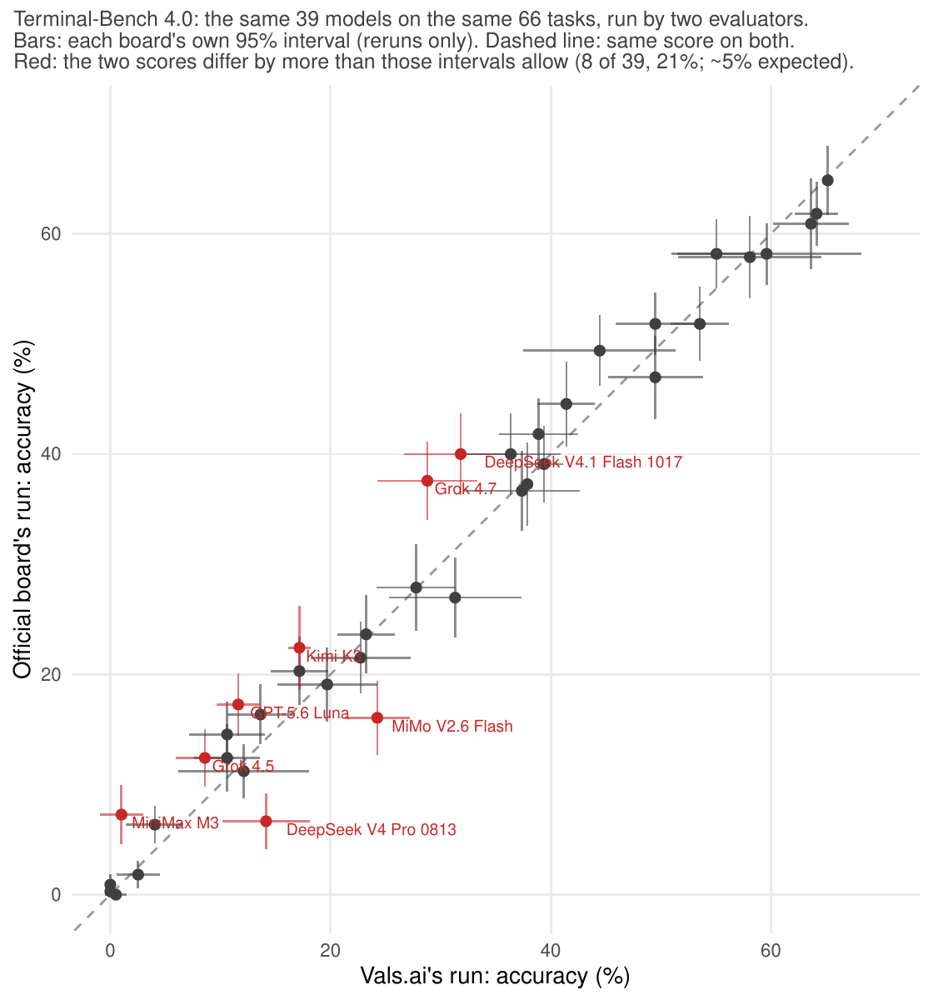{width="55%" fig-alt="Terminal-Bench 4.0 scores from Vals.ai and the official board for 39 models, with the 8 that differ by more than the boards' intervals allow in red."}

Once we put reasonable CIs on benchmarks, we can see how silly it is when we fight about a 2-point lead. This is the top of Vals.ai's Terminal-Bench 4.0 board. Grey are CIs based on rerun noise, which is what the leaderboard reports. Red also accounts for which tasks were picked and who runs the model. That's not ideal, but it's better. Under the better intervals, fully 10 models tie with the leader!

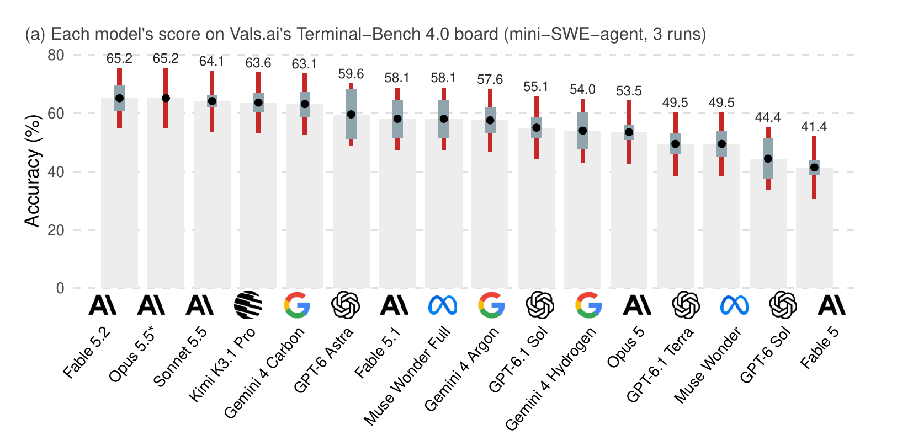{width="85%" fig-alt="The top 16 models on Vals.ai's Terminal-Bench 4.0 board, where 10 tie with the leader under the wider red intervals."}

These intervals do not account for everything. They leave out each harness's average shift (one harness runs every model on Vals.ai's board, so it leaves the ranks unchanged), the checker version (Terminal-Bench 4.1's fixed checkers moved official scores by -1.2 to +2.7 points, and Vals.ai's board is 4.0), and rewording of each task's instructions.

Many leaderboards fall short of even the naive interval. SWE-bench and τ-bench report no interval at all. MLE-bench, PaperBench, Vals.ai, and Terminal-Bench report intervals from reruns alone, which hold the tasks fixed. OpenAI's system cards say their own resampling approach "can lead to overly tight confidence intervals."

If you run a leaderboard, please show the red CI. These intervals account for which tasks were picked and how each model was run, along with reruns. To pilot, run a few models under 2-3 harnesses or prompts.

**Total Evaluation Error**

To get reasonable estimates of that noise, the paper introduces Total Evaluation Error (TEE). The name follows total survey error, which treats every stage of a measurement pipeline as a source of error. TEE uses a mixed model to split the variance among items, prompts, judges, temperatures, reruns, and their interactions. It builds on generalizability theory and uses its standard estimators. For agents, the harness sets the system prompt, the tools, and the agent loop, so different harnesses count as different prompt variants.

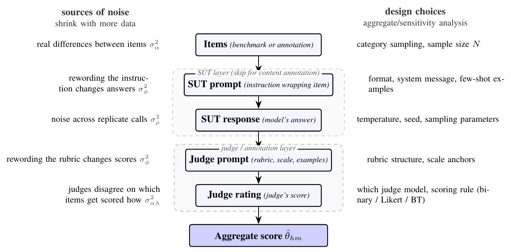{width="80%" fig-alt="Diagram of an LLM evaluation pipeline from items to final score, with the noise each stage adds and the matching design choice."}

**What we found**

*Judges dominate safety ratings.* On AILuminate v1.0 safety prompts from MLCommons, scored by a panel of three LLM judges, judge-related terms account for 73% of the variance! In our safety and ideology applications, naive standard errors are 53 - 70% smaller than the corrected SE.

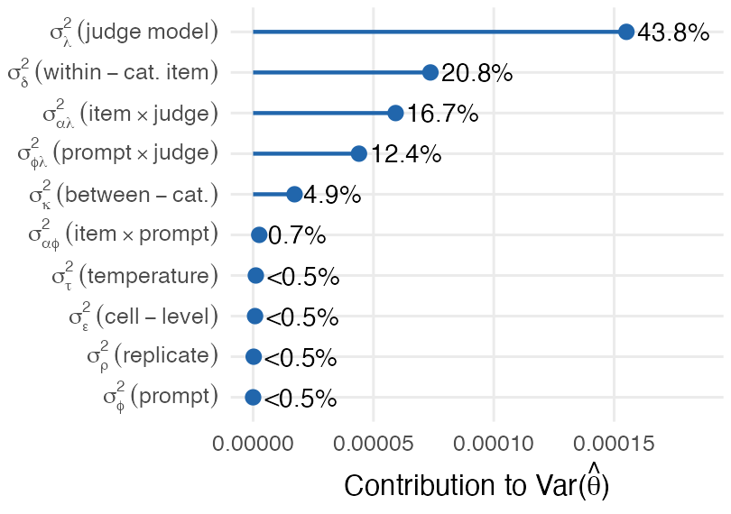{width="65%" fig-alt="Variance components for AILuminate, where judge-related terms account for 73% of the variance."}

*Averaging lowers the error itself.* A small pilot can show you where error comes from, and hence what to average over. On AILuminate, scoring with 3 prompts and 3 judges instead of one reduces the score's error by about half, for 9× the API calls. That's a much better allocation than spending API calls on replicates from the same model and prompt. Running the full factorial design takes 120× the calls, for only an extra 5% reduction. In the paper's SI, a small pilot recovers the qualitative design guidance of a full run 8 times larger.

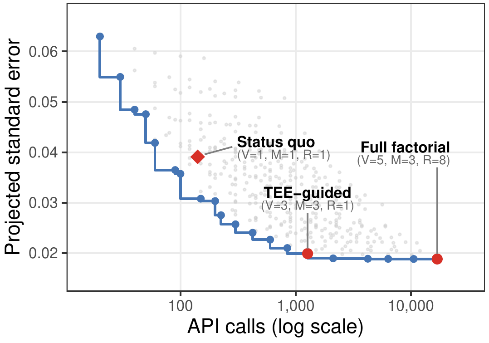{width="70%" fig-alt="Projected standard error against API calls for 360 AILuminate designs, where 3 prompts and 3 judges about halve the error for 9 times the calls."}

*More data, worse coverage.* On Chatbot Arena matches scored by LLM judges, naive 95% CIs from one judge and one prompt cover the 3-judge × 5-prompt average reasonably well at 100 matches, but only 78% of the time at 2,000, while TEE's stay at or above 95%. More data narrows the interval around one configuration's average, so coverage gets worse.

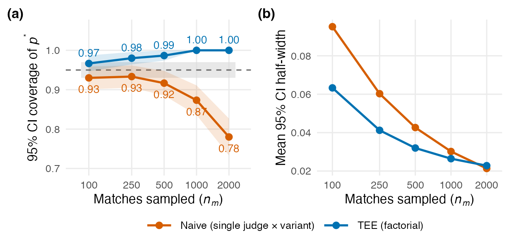{width="85%" fig-alt="On Chatbot Arena, naive interval coverage falls as matches increase, while TEE coverage stays at or above 95%."}

*Scores get closer to ground truth.* On MMLU, when we spend the same API budget where TEE says, scores at larger budgets end up much closer to true accuracy than with the standard approach.

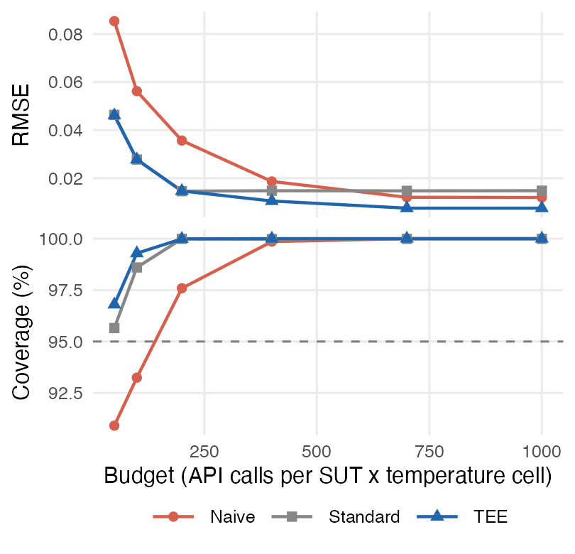{width="60%" fig-alt="MMLU estimation error and coverage by API budget, where TEE-guided allocation has the lowest error at large budgets."}

**What to do about it**

So what to do? In our paper applications, when a pipeline has an LLM judge, averaging across multiple judges reduces error more than any other single change. Don't rest results on one judge model or prompt template. For agent leaderboards, run models under more than one harness. To help ensure generalizability, once you have variation over judge and prompt/harness, you can sample more items. And run a small pilot first -- I suggest at least 30 items, 3 prompts, 2 judges, and 3 replications, or about 540 API calls in the paper. The [R package](https://github.com/SolomonMg/totalevalerror) fits a decomposition from pilot data, projects standard errors under other designs, and recommends budget allocations.

**What TEE can't tell you**

TEE focuses on reliability. You need gold standard data to understand how often a judge is correct, whether you have a valid construct, and whether the items actually cover that construct. If you don't have coded hate speech (dog whistles), your toxicity benchmark will give precise but incomplete estimates. The framework also doesn't account for variance from reasoning traces, and my demonstrations are English-only with models served via API.

**How this paper came about**

This work started with our [Nature paper on state media and LLMs](https://doi.org/10.1038/s41586-026-10506-7), see also ([project site](https://state-media-influence-llm.github.io)), with Hannah Waight, Eddie Yang, Yin Yuan, Molly Roberts, Brandon Stewart, and Josh Tucker. I looked for a framework like this but couldn't find one. The confidence intervals in that work do not use TEE, though the website already uses multiple judges as TEE recommends, and I'll update the website soon. 

Peter Mattson at MLCommons asked me to think about this and try to figure out a framework for AI benchmarks, starting with their safety benchmark AILuminate, which became the paper's first example. Thanks to MLCommons for supporting this work, along with NYU's Center for Social Media, AI, and Politics, particularly Josh Tucker and Jonathan Nagler. Thanks also to participants at the 2026 CSMAP conference for helpful feedback. And thanks for the feedback and early conversations that shaped this paper to Chris Barrie, Ben Guinaudeau, Aaron Kaufman, Brandon Stewart, Kylan Rutherford, Bennett Hillenbrand, Andrew Gruen, Rebecca Weiss, Hannah Waight, Molly Roberts, Eddie Yang, Melina Much, Joe Higton, and Jennifer Allen.

**On using AI**

This work would not have happened without Claude Code (Claude Opus 4.6, 4.7, 5, and 5.5) to help:

- massively expand the literature search
- multiple round of critical review on initial drafts of the paper, suggesting improvements
- thinking through additional sources of potential variation in LLM pipelines
- search for and collect extant data that helps demonstrate the problem in the real world, including the leaderboard data in this post
- draft and recheck the code for data collection, analysis, simulations, figures, and the R package
- check every number in the paper against code output multiple times
- fact-check claims against primary sources
- cleanly move the content between journal/venue formats, including Neurips poster and slides
- draft the 55-page SI Appendix, TiKZ diagrams, LaTeX math, etc. 


**Paper:** [arXiv 2604.11581](https://arxiv.org/abs/2604.11581) ([SI Appendix](/pdf/totalevalerror_si.pdf))

**R package:** [github.com/SolomonMg/totalevalerror](https://github.com/SolomonMg/totalevalerror)

**Replication files:** [github.com/SolomonMg/totalevalerror-replication](https://github.com/SolomonMg/totalevalerror-replication)

Come see the poster in Sydney: Wednesday, December 9, 10 AM - 1 PM AEDT, Hall 1-4.
